# Focus

**A calm, offline study companion for Android: a Pomodoro timer, study statistics, goals, a weekly routine and spaced reviews in one minimal app.**

Focus has no account, no ads, no analytics and no internet permission. Everything stays on the device.

<p align="center">
  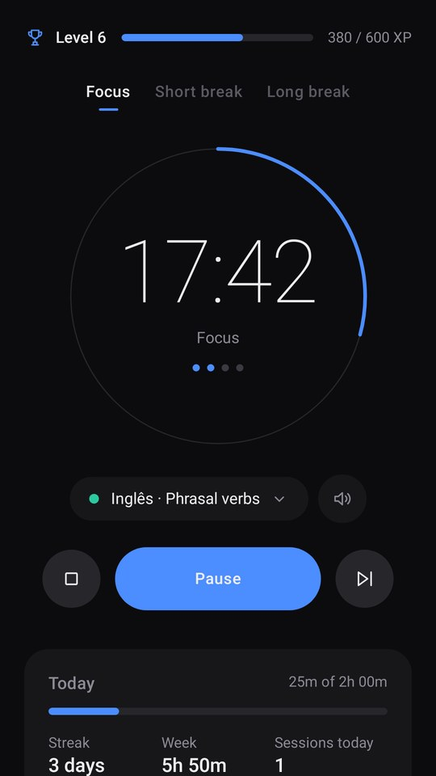
  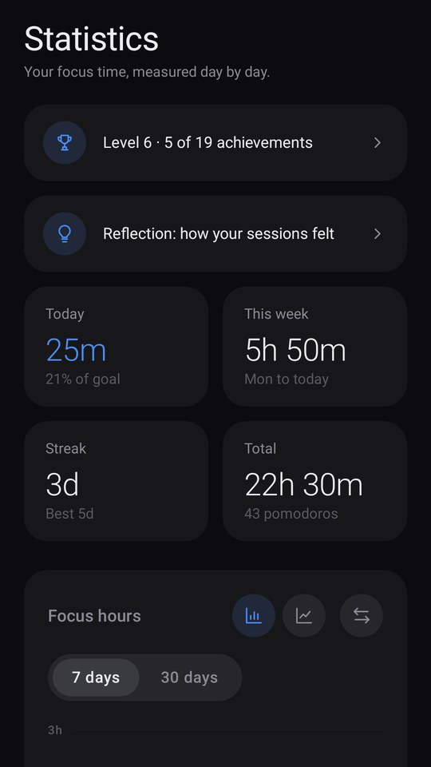
  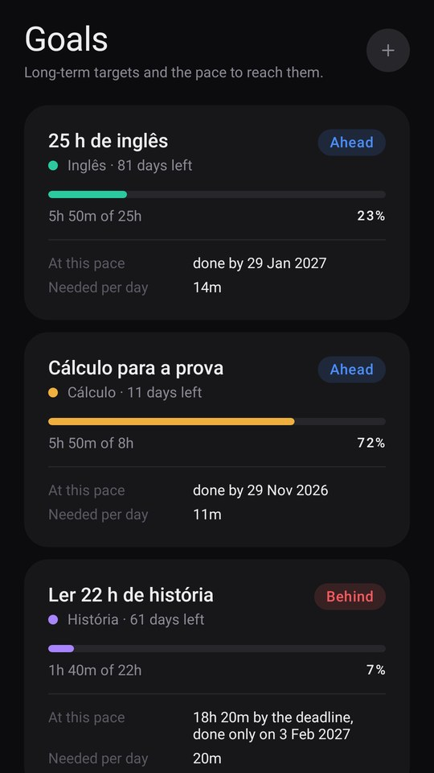
  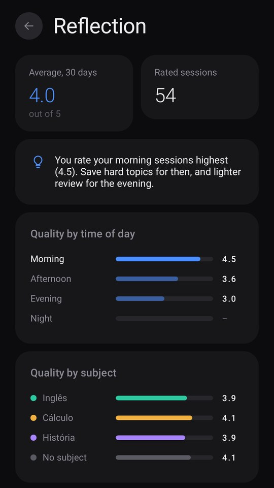
</p>

## Features

### Focus
- **Pomodoro timer** with configurable focus, short and long breaks, cycles and auto-start. It keeps running in the background through a foreground service and notification.
- **Five timer styles:** ring, ticks, gauge, analog dial and minimal.
- **Subjects and tasks:** link each session to what you are studying.
- **Focus sounds:** rain, white, pink and brown noise, and ocean. They are synthesized on the device in real time, so there are no audio files. They play only while a focus is running.
- **App blocking:** during a focus, Focus warns you, or optionally blocks the screen, when you open an app from your list. Without the Usage Access permission it still reminds you when you leave the app.

### Progress
- **Statistics:** today, week, streak, totals, 7 and 30-day charts (bars or line, with comparison to the previous period), focus by hour of day, and time per subject.
- **Yearly heatmap:** one square per day, with intensity relative to your daily goal.
- **Rest days:** up to two planned days off per week that don't break your streak.
- **XP, levels and 19 achievements**, with unlock notifications.
- **Reflection:** rate each session from 1 to 5 and add a note. Insights show when and in which subject you focus best.

### Planning
- **Goals:** long-term targets (for example "40 h of English by March") with pace forecasts and the time needed per day.
- **Weekly routine:** fixed study blocks per weekday with reminders.
- **Spaced reviews:** a review reminder 1, 7 and 30 days after you study a topic.
- **Weekly summary** notification on Sundays.

### Everywhere
- **Home screen widget:** start or pause, today's progress and your streak.
- **Themes:** system, dark, OLED (pure black) and light, with 9 accent colors tuned for each theme.
- **English and Portuguese**, switchable in the app.
- **Encrypted backup:** export and import all your data to a file.

<p align="center">
  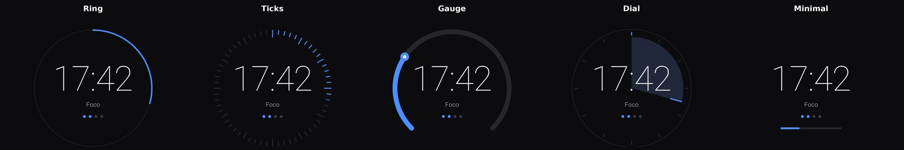
</p>
<p align="center">
  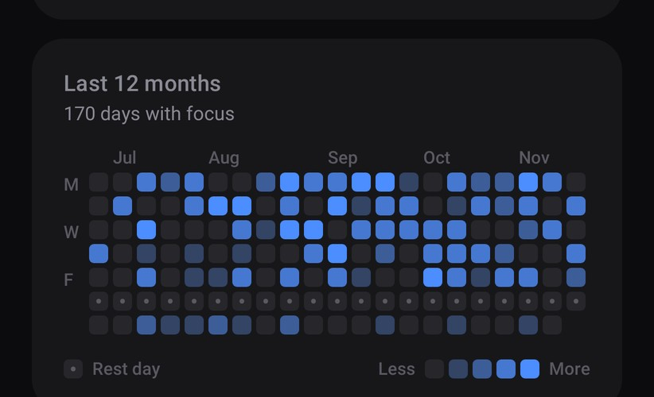
</p>
<p align="center">
  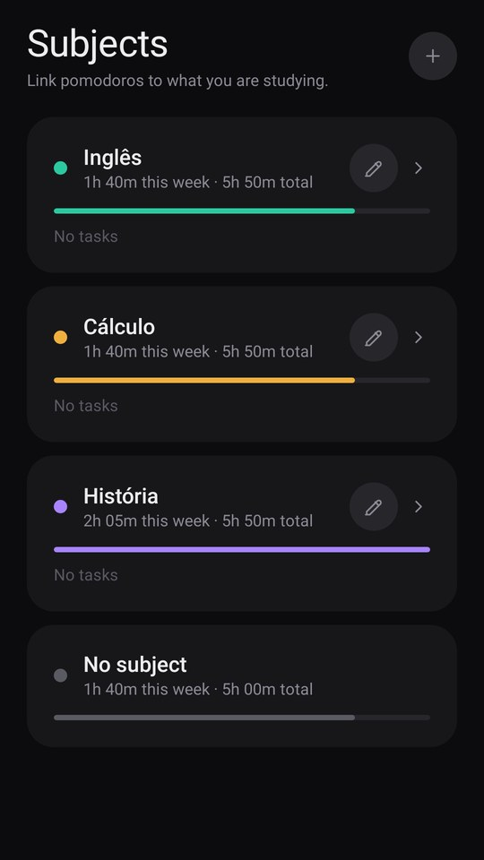
  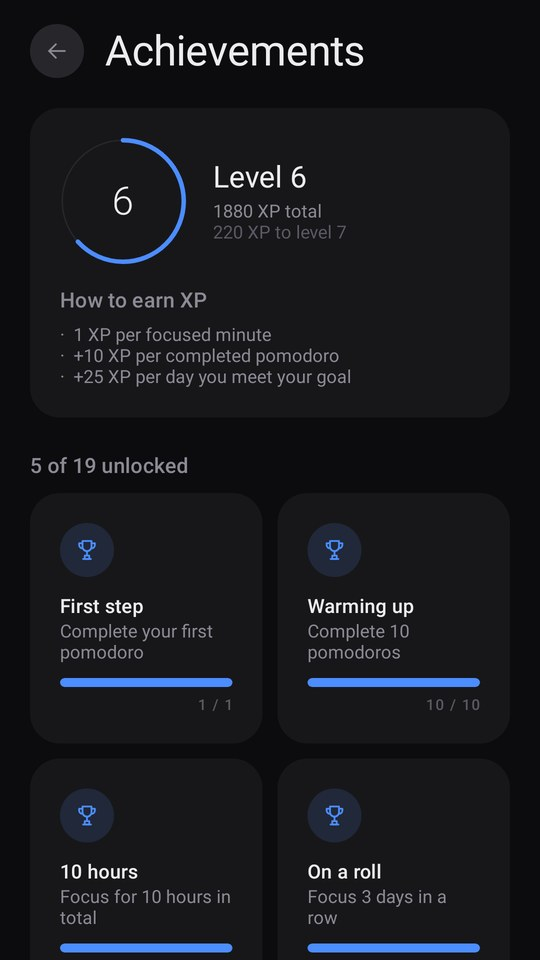
  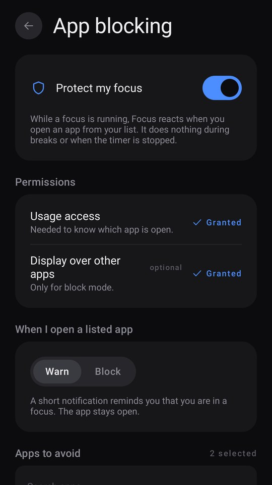
  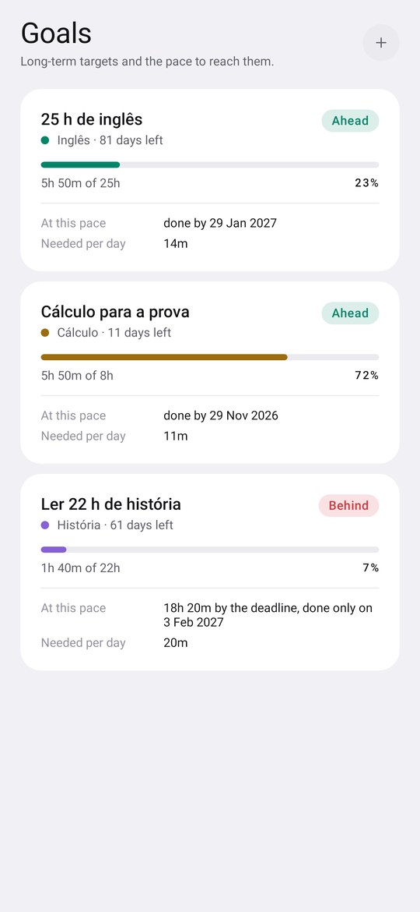
  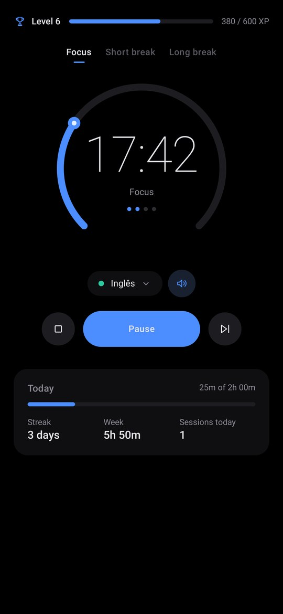
</p>

## Tech stack

| Area | Choice |
| --- | --- |
| Language | Kotlin 2.2 |
| UI | Jetpack Compose (Material 3, custom design system), Canvas charts, hand-drawn stroke icons |
| Architecture | Multi-module, MVVM with unidirectional state (`StateFlow`), Hilt for dependency injection |
| Storage | Room (exported schemas, auto-migrations), DataStore Preferences |
| Background | Foreground service for the timer, `AlarmManager` inexact windows for reminders (no exact-alarm permission) |
| Build | Gradle version catalog, convention plugins in `build-logic/`, R8 with resource shrinking |
| Tests | JUnit for pure calculators, Robolectric for database migrations, backup and screen rendering |
| SDK | `minSdk` 26, `targetSdk` and `compileSdk` 36, 16 KB page-size compatible |

## Project structure

```
app/                  Application, MainActivity, navigation, Plan tab
build-logic/          Convention plugins shared by every module
core/model            Plain Kotlin models (settings, sessions, goals, routine, reviews)
core/database         Room database, DAOs and exported schemas (core/database/schemas)
core/data             Repositories, pure calculators (stats, gamification, goals, reminders), encrypted backup
core/designsystem     Theme (dark, OLED, light + accents), components, charts, timer faces, icons
core/timer            TimerController state machine, TimerService, timer notifications
feature/focus         Timer screen, subject picker, focus sound picker
feature/stats         Statistics and yearly heatmap
feature/settings      Settings, privacy policy, open source licenses
feature/subjects      Subjects and tasks
feature/achievements  XP, levels, achievements and unlock notifications
feature/goals         Long-term goals
feature/reflection    Post-session rating prompt and insights
feature/routine       Weekly routine
feature/review        Spaced reviews
feature/reminders     Reminder scheduling, boot and time-change rescheduling, weekly summary
feature/blocker       App warnings or blocking during a focus
feature/sounds        Real-time noise synthesis and playback
feature/widget        Home screen widget
```

Calculators such as statistics, streaks with rest days, XP, goal pace, reminder planning and the weekly summary are plain functions with no Android dependencies, so they are unit-tested directly.

## Building

> The application id is still `com.focus.app`, a placeholder. Choose your own before the first upload to Google Play, because it can never change after that. Set it in `app/build.gradle.kts`.

Requirements: JDK 17 and the Android SDK (platform 36). A recent Android Studio opens the project directly.

```bash
./gradlew assembleDebug          # debug APK (app id suffix .debug)
./gradlew testDebugUnitTest      # all unit and Robolectric tests
./gradlew assembleRelease        # minified release APK
./gradlew bundleRelease          # Android App Bundle for Google Play
```

### Local configuration (not committed)

Two kinds of secrets are read from the environment or from git-ignored files. Neither is in the repository.

**Release signing.** Create an upload key with `scripts/create-upload-key.sh [path/to/key.jks]`. It creates the keystore (by default `~/focus-upload.jks`, outside the project) and a `keystore.properties` file, which `.gitignore` excludes. On CI, use these environment variables instead:

```
FOCUS_KEYSTORE_FILE  FOCUS_KEYSTORE_PASSWORD  FOCUS_KEY_ALIAS  FOCUS_KEY_PASSWORD
```

Without them, release builds are left unsigned.

**Backup encryption key.** Backups are AES-256-GCM files. The key is 64 hex characters, set in `local.properties`:

```properties
focus.backupKey=<64 hex characters>
```

You can also set the `FOCUS_BACKUP_KEY` environment variable. Without it, the build uses a public development key and prints a warning. That is fine for local builds, but backups made with it can be read by anyone who knows this repository. Keep the same key across releases, or older backups can't be imported.

## Privacy and permissions

Focus works fully offline and declares no `INTERNET` permission. Each permission is explained in the app before it's requested.

| Permission | Why |
| --- | --- |
| `POST_NOTIFICATIONS` | Timer, reminders, achievements and focus warnings |
| `FOREGROUND_SERVICE`, `FOREGROUND_SERVICE_SPECIAL_USE`, `WAKE_LOCK` | Keep the running timer alive in the background |
| `RECEIVE_BOOT_COMPLETED` | Reschedule reminders after a restart |
| `PACKAGE_USAGE_STATS` (optional) | App blocking: see which app is open, only during a focus. Nothing is stored. |
| `SYSTEM_ALERT_WINDOW` (optional) | Show the block screen over a listed app |

Launcher apps are queried through a `<queries>` intent filter, without `QUERY_ALL_PACKAGES`, and no Accessibility service is used. On Android 13 and newer, sideloaded builds may show Usage Access as a "restricted setting". The app explains how to allow it.

The full privacy policy is bundled in the app (Settings > Privacy policy).

## Contributing

Code, identifiers and comments are in English. User-facing text lives in string resources: `values/` for English and `values-pt/` for Portuguese. Please add both when you add a string, and keep both themes and both languages in mind for UI changes. Run `./gradlew testDebugUnitTest` before opening a pull request.

## License

Copyright 2026 Deuzivan. Licensed under the [Apache License, Version 2.0](LICENSE). See [NOTICE](NOTICE).

Third-party libraries are listed with their licenses in the app (Settings > About > Open source licenses). The list is generated at build time by the [AboutLibraries](https://github.com/mikepenz/AboutLibraries) Gradle plugin.
